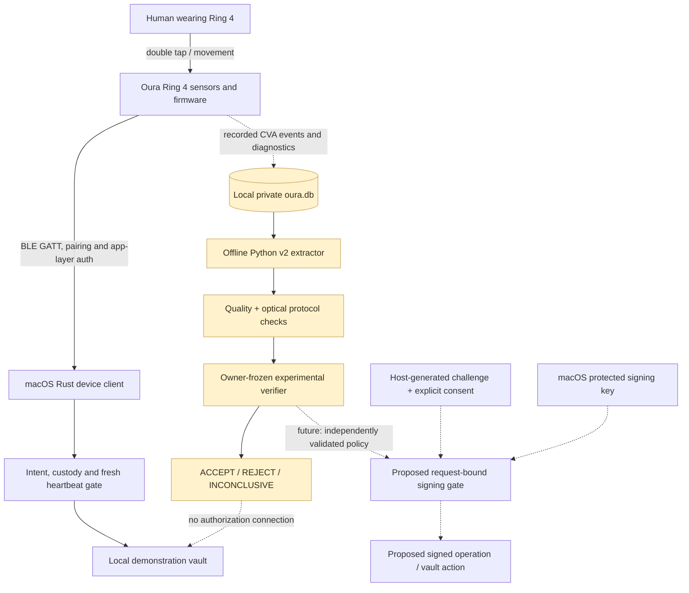

# Pulse Key

**Experimental cardiovascular authentication | Oura Ring 4 · Rust/macOS · Python signal analysis · BLE reverse engineering · adversarial security research**

Pulse Key asks a specific security question: **can a wearable establish that its enrolled owner is wearing it, using fresh optical cardiovascular measurements, before a local authorization or signing decision?** The engineering prototype already demonstrates a ring-mediated unlock ceremony; the research effort investigates whether it can reliably recognize the *wearer* under new sessions, different people, physiological variation, and active attacks.

The immediate target is **one enrolled person, one physical research ring, independently repeated measurements, and a conservative decision**. A practical eventual deployment would combine device custody, deliberate user intent, fresh sensor acquisition, wearer verification, and request-bound cryptographic authorization. Each has a separate trust boundary.

> [!IMPORTANT]
> **Scientific/security status: research prototype, as of 20 November 2026.** The historical macOS Rust demo was reported working on hardware, but its source is **not yet in this repository**. The committed Python identity verifier is an **offline shadow engine**, deliberately returning `"authorized": false` even for a research `ACCEPT`. Reliable wearer identity, replay resistance, and production-grade biometric error rates have **not** been established. This repository is an engineering and experimental record, not a certified authentication product.

## 1. Evidence-backed implementation status

| Area | Status | Concrete evidence / limitation |
|---|---|---|
| **Physical Ring 4 / local vault demo** | **Historically demonstrated; source pending import** | Reported double tap → fresh heartbeat measurement → local unlock; wear removal → relock. Approximately 18-second measurement and 11-second removal-to-relock in an October demonstration. A **126-test Rust workspace** was reported then; the code and hardware are not currently available for independent CI verification here. |
| **BLE/protocol investigation** | **Documented research; partial local empirical support** | Reverse-engineered Oura GATT transport, application-level authentication, live HR/IBI, accelerometer events, CVA sampling, and stored optical diagnostics. External protocol references are cited below. |
| **Offline identity verifier v2** | **Implemented in repository** | SQLite read-only adapter, corrected CVA reconstruction, optical register corroboration, PPG signal processing, owner enrollment, tri-state decision, CLI, unit and optional private-data regression tests. |
| **Automated offline tests** | **14 passed, 6 skipped in standalone snapshot** | Six additional tests require the private historical Oura DB/audit. The November 3 isolated historical replay **reported 20 passing tests** with those inputs. Passing tests validate software expectations, not biometric security. |
| **Historical same-ring X/Y pilot** | **Exploratory, post-hoc** | Nine owner-X vs six wearer-Y bursts; calibration differences separated in this small set. Only one held-out quality-passing X and two Y were decisive after training. |
| **Independent public-ring research** | **Archived + reusable data** | 20 publicly released, pseudonymized third-party ring files (~1.33 GB), stored as [GitHub Release assets](https://github.com/Rayan-and-beyond/Pulse_Key/releases/tag/reference-recordings-v1). Older v1 cross-device comparisons require reevaluation with corrected v2. |
| **Prospective wearer study / secure signing** | **Specified, not implemented** | Frozen multi-day owner reseats, blinded unfamiliar-wearer trials, anti-replay evidence, local key protection and request-bound signing remain engineering gates. |

**Source-of-truth rule:** start with [current evidence](docs/research/current/2026-11-03_MASTER_EVIDENCE_AND_STATUS.md) and [supersessions/errata](docs/research/current/2026-11-03_SUPERSESSION_AND_ERRATA.md). Old numerical claims should be interpreted through the corrected decoder record rather than reused as current performance.

## 2. System architecture and trust boundaries



*Solid edges represent the documented demo/research flow (the Mac demo source awaits import). Dashed edges represent offline acquisition paths or future integration. The offline verifier has no executable authorization edge to the vault.*

### Reported live control flow (conceptual)

The source for the original Rust runtime is still pending import, so the labels below describe the **observed demonstration behavior**, not claimed Rust enum names:

```text
LOCKED
  | explicit double tap
  v
MEASURING -- incomplete/stale pulse, timeout, ring removal --> LOCKED
  | fresh acceptable live heartbeat + custody
  v
UNLOCKED -- ring removal or local session termination --> LOCKED
```

This flow gates a local demonstration vault by custody, user action and liveness. A different individual could wear the same ring and trigger it. The offline identity verifier is isolated and must not silently alter this live transition graph. The exact source-level concurrency, cancellation and timeout logic will be reviewed only after the original Rust workspace is imported.

### Component responsibilities

| Boundary | Input → output | Security property | Current verification |
|---|---|---|---|
| **Device transport** | Bonded BLE link, GATT commands and notifications → framed sensor events | Access to the expected peripheral | Protocol behavior documented; no proof of authenticated sensor origin through an attacker-controlled host |
| **Intent** | Motion/accelerometer tap pattern → double-tap event | Deliberate physical action | Exercised in historical live demo; not an enrolled-wearer identity check |
| **Physiological freshness/custody** | Live HR/IBI and wearing state → timed vault session | Fresh measurement + continued possession | Demonstrated in historical demo, not attack-certified; relock is subject to detection latency |
| **Measurement reconstruction** | Timestamped `oura.db` CVA packets → numeric PPG and calibration | Recover faithful physical samples | v2 packet-anchoring and calibration parser regressions checked; historical private replay documented |
| **Identity research** | Frozen owner profile + quality-passing signal → `ACCEPT`, `REJECT`, or `INCONCLUSIVE` | Experimental wearer discrimination | Very small retrospective study; **no deployment decision** |
| **Future authorization** | Challenge, policy, high-confidence eligible capture, tap → signature | Bind approval to exact request and expiry | **Design only**; no signing gate, attestation, or end-to-end relay defense implemented |

The original Mac workspace was reported at `~/Desktop/OuraDeepSeek`, with a Rust crate at `ring/crates/pulse-key`. [Import plan](docs/MAC_IMPORT.md) explains how to bring that code into `mac-daemon/` safely. The local-only ring key, database, private enrolment data, and capture logs are intentionally excluded.

## 3. Hardware, BLE and protocol engineering

### Oura Ring 4 access layer

Public reverse-engineering projects document a proprietary GATT service and transport framing, with firmware-specific differences requiring validation on the actual ring. The commonly documented map is:

| Interface | UUID or format | Function |
|---|---|---|
| Primary service | `98ed0001-a541-11e4-b6a0-0002a5d5c51b` | Ring protocol |
| Write characteristic | `98ed0002-a541-11e4-b6a0-0002a5d5c51b` | Host requests |
| Notify/read characteristic | `98ed0003-a541-11e4-b6a0-0002a5d5c51b` | Ring responses/events |
| Frame structure | `tag:u8 | payload_length:u8 | payload` | Tagged, length-prefixed messages; a BLE notification may carry multiple events |
| Ordering/encoding | Little-endian for known numeric payloads | Decoder must enforce exact bounds and packet sequencing |

**Authentication is layered.** Bluetooth OS bonding/link encryption and the ring's application protocol authentication are separate controls. Published reverse engineering describes a per-ring **16-byte application key** and AES-128 challenge-response based on a fresh **15-byte challenge**. Relevant documented protocol operations include `SetAuthKey` (`0x24`) and extended challenge/authentication operations under `0x2F`. This authenticates protocol access at that layer; it **does not attest that a particular human supplied the physiological signal**, nor does it guarantee application-level replay or relay resistance. No private key, challenge transcript, or live authentication credential is committed here.

**Event streams investigated:** the reported CVA sampler feature is `0x0D`; `0x81` CVA waveform events (~50 Hz, roughly 1,500 samples for a complete ~30-second burst), `0x43` ASCII optical calibration messages, `0x61` subtype `0x33` binary diagnostic records, `0x47` motion indicators, and `0x82` mid-burst scan indicators. Other reported streams include live inter-beat/heart-rate observations, acceleration and temperature. **PPG is an optical pulse signal; it is not ECG.** Hardware teardown reports an optical front end and selectable paths; we have **not** demonstrated simultaneous raw access to 18 independent channels or decoded physical emitter/detector geometry.

Protocol references: [open_oura](https://github.com/Th0rgal/open_oura), [open_ring specification](https://github.com/LogosIsLife/open_ring/blob/master/PROTOCOL.md), [ringverse BLE map](https://github.com/ringverse/protocol/blob/main/oura/BLE.md), [Ring 4 transport notes](https://github.com/Defying/oura-ring4-ble/blob/main/docs/protocol-notes.md), and [hardware/literature inventory](docs/research/history/2026-11-02_LITERATURE_AND_HARDWARE_REFERENCES.md). Third-party protocol claims are references, not independently verified captures from this repository's current code.

### Physical operating discipline

Testing is confined to the **older, retired research ring** and the owner's explicitly consented recordings. Preserve its current pairing state. The newer/sealed ring, factory reset, firmware flashing, key reprovisioning and destructive hardware operations are outside this experiment. Optical fit, pressure, motion, sensor orientation and temperature are possible confounders requiring controlled measurement.

## 4. Offline data model and measurement pipeline (implemented)

The [current v2 source](research/identity/phase1_v2/) runs entirely offline, reads a local SQLite `events` table with `mode=ro`, and **never communicates with the wearable or sends a network request**. It exposes `list`, `enroll`, `verify`, and `backtest` commands. Underlying modules:

| File | Implementation |
|---|---|
| [`observations.py`](research/identity/phase1_v2/observations.py) | Discover CVA sessions, parse pre-burst ASCII/binary calibration and quality metadata, read SQLite without mutation |
| [`feature_extraction.py`](research/identity/phase1_v2/feature_extraction.py) | Packet-relative PPG reconstruction, filtering, pulse segmentation, APG-DCT16 embedding, upstroke measures |
| [`verifier.py`](research/identity/phase1_v2/verifier.py) | Owner-only profile enrollment, thresholds, per-modality decision, quality abstention, `authorized:false` |
| [`pulsekey_identity.py`](research/identity/phase1_v2/pulsekey_identity.py) | Research CLI and read-only chronological replay |
| [`tests/test_verifier.py`](research/identity/phase1_v2/tests/test_verifier.py) | Synthetic deterministic tests plus optional real-DB regression cases |

### 4.1 Capture discovery and corrected waveform reconstruction

The adapter discovers event tag `129` (`0x81`) and groups packets into a burst by nearby ring timestamps. The waveform starts at a single **absolute-marker packet**. Subsequent Rust-decoded `ppg_samples` entries are **already cumulative offsets relative to the start of their own packet**. They must be added to the fixed packet anchor, then the anchor advances to that packet's last reconstructed value:

```text
absolute marker:       [100, 110]           => 100, 110
next packet offsets:   [  3,  -4,   2]     => 113, 106, 112  (anchor 110)
next packet offsets:   [  1,   4]         => 113, 116       (anchor 112)
```

This is a substantive **3 November 2026 decoder repair**. The archived v1 inadvertently double-integrated within-packet offsets. v1 owner profiles, thresholds and waveform comparisons **must not be mixed** with the corrected v2 model. The corrected profile schema is `pulse-key-offline-identity-v2-corrected-ppg`. Multiple absolute-marker packets or a relative packet arriving before its marker cause an error, not a fabricated waveform. See the [measurement correction](docs/research/current/2026-11-03_MEASUREMENT_CORRECTION.md).

### 4.2 Optical telemetry and instrument corroboration

Before the CVA burst the ring reports ASCII calibration records matching `E:3N...A...` and `E:5N...A...` through event tag `0x43`. The adapter retrieves the last valid `N3`, `N5` and ADC readings in the bounded pre-capture interval and computes:

$$
\Delta N = N_5 - N_3
$$

Independent tag `0x61` diagnostic packets with subtype `0x33` contain 8- or 14-byte records. The v2 parser decodes one or two **6-byte slot/DAC/config tuples**, then checks that the expected register-step **multisets** agree with the ASCII step counts. The frozen history has **15/15 multiset correspondences** after correction. Multiset equality does **not** establish chronological register writes, specific optical wavelengths, anatomical path adjacency, or a wearer-stable physiological fingerprint.

Strict eligibility requires present optical calibration, corroborated binary traces, absence of mid-burst `0x82` scans and `0x47` motion, and adequate waveform reconstruction. The `quality()` gate returns named reasons such as `missing_optical_calibration`, `uncorroborated_calibration_protocol`, `mid_burst_scan`, `motion_during_capture`, `poor_or_missing_waveform`, and `short_capture`.

### 4.3 PPG signal processing and morphology features

The code implements the following sequence for a qualifying 50 Hz CVA waveform:

```text
~1,500 samples / ~30 s @ 50 Hz
  → detrend by median
  → 5× interpolation to 250 Hz for computational crossing estimates
  → third-order Butterworth bandpass, 0.5–12 Hz, zero-phase application
  → evaluate both signal polarities; detect systolic peaks + preceding valleys
  → reject implausible intervals / amplitudes / rise times
  → normalize individual beats to 128 sample positions
  → median beat and within-burst coherence gate
  → Savitzky–Golay second derivative (APG)
  → orthonormal DCT-II coefficients 1..16, L2 normalized
  → 16-D morphology embedding + 10–50% rise time + crest duration
```

**Implementation details:** `features()` requires at least 850 source samples; `quality()` applies a stricter 1,300-sample burst gate. The peak selector requires at least 13 peaks, the accepted result at least **12 usable beats**, **15 valid rise measurements**, and median beat coherence **≥ 0.50**. The source uses 0.5–12 Hz filtering, per-polarity scoring, peak/valley timing bounds, and Euclidean distances between 16-D normalized vectors. Resampling to 250 Hz improves *numerical interpolation*; it does not increase physical sensor bandwidth.

### 4.4 Owner enrollment, scoring and authorization isolation

The verifier requires **three distinct, quality-passing owner captures**. It freezes the observed calibration interval with configurable integer slack (default **2 counts**) and a nearest-reference waveform distance threshold from leave-one-out owner distances (default **1.15 multiplier**). Enrollment captures cannot score as independent verification probes. A profile containing derived pulse features is sensitive and must stay local with restrictive file permissions.

```text
IF probe is an enrollment capture      → INCONCLUSIVE
ELSE IF optical/protocol/PPG gate fails → INCONCLUSIVE
ELSE IF optical AND waveform pass       → research ACCEPT
ELSE                                   → research REJECT
ALWAYS                                 → authorized = false
```

The implementation deliberately uses a two-modality **AND** decision on eligible captures. A result of `INCONCLUSIVE` means **insufficient evidence** and must be counted separately from an eligible impostor rejection. The historical calibration slack was chosen after looking at prior X/Y data, so the current acceptance interval is **not** an independent estimate of real-world performance.

## 5. Measured experiments, with explicit limitations

### 5.1 Same-physical-ring historical pilot

Two coded wearers contributed **15** Ring 4 CVA bursts: **9 X**, **6 Y**. In that exploratory set, `N5−N3` fell in `[-3,0]` for every X capture and `[+1,+3]` for every Y capture. The actual replay used a historical owner optical acceptance interval **`[-5,0]`**, derived using a tolerance selected after exploratory analysis.

The **corrected v2**, with three owner enrollment captures, yielded the following recorded scores on quality-passing held-out bursts:

| Held-out burst | Label | Corrected v2 APG-DCT16 distance | Waveform gate | Optical `N5−N3` | Combined research verdict |
|---|---|---:|---|---:|---|
| One later owner X | X | **0.170049** | PASS | 0 | `ACCEPT` |
| First later Y | Y | **0.188865** | PASS | +3 | `REJECT` (optical) |
| Second later Y | Y | **0.196780** | PASS | +2 | `REJECT` (optical) |

Owner-fitted v2 waveform threshold: **0.517940**. Both Y waveforms passed it. By chronological held-out attempts: **X: 1 ACCEPT / 0 REJECT / 2 INCONCLUSIVE** and **Y: 0 ACCEPT / 2 REJECT / 4 INCONCLUSIVE**. These measurements were replayed from previously examined data, under a small and non-blind development sample. They do not establish an operational FAR, FRR, EER or resistance to a stranger wearing the ring.

The original v1 threshold **0.793096** and earlier waveform distances were invalidated for Oura waveform interpretation by the reconstruction correction. See [independent offline reproduction aggregates](docs/research/current/2026-11-03_OFFLINE_REPRODUCTION_AGGREGATES.json), [measurement correction](docs/research/current/2026-11-03_MEASUREMENT_CORRECTION.md), and [errata](docs/research/current/2026-11-03_SUPERSESSION_AND_ERRATA.md).

### 5.2 Multi-participant external ring-signal experiments

The repository holds the **research team's processing and experiments**, plus a release containing **20 original, publicly released third-party ring recordings**. These recordings were **collected by a different research team**, on different wearable hardware. They are de-identified/pseudonymized research data and are **not our own human-subject acquisition**. The source project and its authors are credited in the [benchmark provenance](research/benchmarks/public_waveform/README.md). The recordings are released under **CC BY-NC 4.0 (Attribution–NonCommercial)**. Preserve the source link and license in any redistribution; commercial use requires separate permission. The dataset documentation also limits re-identification attempts.

- **Release:** [reference-recordings-v1](https://github.com/Rayan-and-beyond/Pulse_Key/releases/tag/reference-recordings-v1) contains **20 `P*_Ring_raw.npz` files (1,326,368,955 bytes in total)**, plus `SHA256SUMS.txt` and `MANIFEST.json`. Filenames retain pseudonymous participant IDs; they do not disclose real names.
- **Sensor modalities:** 100 Hz green/IR ring PPG, 3-axis motion and temperature (100 Hz wearable data; temperature originally 1 Hz). The source provides additional devices and ECG reference data; this release contains the **ring files only**.
- **Initial quality-screened subset:** 163 nonoverlapping 30-second windows selected from **18** participants; **139** passed the frozen v1 extractor's waveform-quality gate.
- **Historic owner-vs-public v1 comparator:** **82/139** windows scored within the *old*, incorrect Oura-owner waveform threshold. This is **archived only**; it is **not a v2 result, a true impostor false-acceptance rate, or a claim that those participants can unlock Pulse Key**.
- **Within-public-cohort descriptive baseline:** subject-equal later-day APG-DCT16 AUC **0.570** and mid-upstroke timing AUC **0.547**, both weak and sensitive to splits/participant weighting. Repeated windows from the same person are correlated.

**What this data can support:** format/decoder robustness tests, 100→50 Hz resampling comparisons, pulse-feature ablations, artifact handling, within-source cross-day exploratory benchmarks, and reproducible negative evidence. **What it cannot support directly:** proprietary Oura optical calibration `N3/N5`, custody/tap intent, same-physical-Oura stranger acceptance, or generalizable production biometric error rates. The earlier benchmark also predates the v2 owner decoder fix.

The [benchmark code](research/benchmarks/public_waveform/), [frozen results](research/benchmarks/public_waveform/RESULTS.md), and [historical research notes](docs/research/history/) document the dataset origin, 163-window selection manifest, exact old extractor hash and interpretation boundaries.

## 6. Security model and adversarial test program

| Attack or failure | What must be tested | Proposed engineering control / current gap |
|---|---|---|
| **Stolen ring on another wearer** | Same-ring impostor pass across reseats, days and conditions | Prospective frozen X-vs-stranger verification; not validated yet |
| **Recorded or injected pulse** | Replay old CVA/IBI samples, edit SQLite events, forged notifications | Bind capture to a live timed session; authenticate acquisition at the source where technically possible; signed sensor freshness has **not** been demonstrated |
| **BLE relay / peripheral spoof** | Proxy session, replay frames, device impersonation, dropped notifications | Separate OS bond and app-layer challenge from application request/session binding; no verified anti-relay protocol yet |
| **Tap spoof or accidental trigger** | Accelerometer injection, rebound double-tap, user-intent confusion | Explicit intent state, debounce and timed physiological check; historical code must be imported and fuzz-tested |
| **Ring removal/handoff** | Detect removal during capture, before approval and after unlock | Relock on removal, bounded expiry and request cancellation; historical detection latency was nonzero |
| **Host or model compromise** | Stolen profile, altered thresholds, tampered offline DB, unauthorized signing | Local permission controls, integrity manifests, keychain/Secure Enclave-backed signing **proposed**; zero trust in mutable sensor logs |
| **Model drift / physiological stress** | Exercise, cold hands, caffeine, changing contact, skin temperature, sensor orientation | Independent-day enrollment/validation, quality covariates, calibrated `INCONCLUSIVE` policy, recovery factor |
| **Parser / instrument corruption** | Packet order, marker replay, truncation, duplicate bursts, unsupported AFE states | Strict decoder bounds and independent raw-byte fixtures; v2 initial regressions exist; complete hardware-origin tests remain |

**Security invariant for current repository:** the offline model cannot unlock anything; all decisions include `authorized:false`. For a future real authorization system, an `INCONCLUSIVE`, missing signal, lost bond, ring removal, timeout, request mismatch, or untrusted sensor state must withhold approval. Device cryptographic access and human biometric identity are separate proofs. An authentication design must explicitly address host trust and recovery, including attacker access to the Mac.

## 7. Validation program and measurable acceptance gates

The [experimental protocol](docs/research/current/2026-11-03_NEXT_EXPERIMENT_PROTOCOL.md) defines a sequence that prevents treating a two-person post-hoc result as deployment evidence.

| Gate | Engineering work | Objective completion evidence |
|---|---|---|
| **0. Decoder and model freeze** | Import audited local Rust code; compare raw bytes to v2 JSON; test packet boundaries and binary calibration; freeze profiles and hashes | Stable CI suite, raw-byte fixture agreement, immutable run manifest, `authorized:false` preserved |
| **1. Owner repeatability** | **5 independent remove/reseat captures on day 1 + 5 on a separate day** using same research ring | All ten attempted captures logged; screen for **≥9/10 owner ACCEPT** on frozen optical baseline, with INCONCLUSIVE counted explicitly |
| **2. Unfamiliar wearers** | **5 consenting unfamiliar people × 3 fresh reseats × 2 days = 30 attempts**, same physical ring | Blinded verdicts; any eligible stranger ACCEPT falsifies the strict zero-accept claim for those observations; measure person-level and attempt-level results |
| **3. Better candidate comparison** | Predeclared optical-only, corrected waveform-only, calibrated small fusion and quality baselines | Splits disjoint by **person, day and wearing session**; frozen threshold chosen without final test labels; new individuals/sessions confirm |
| **4. Authorization hardening** | Challenge-bound signing, anti-replay state, removal cancellation, explicit tap and fallback factor | Adversarial replay/relay and fault-injection regression suite; independent threat-model review; no premature identity-based live unlock |

The **≥9/10** figure is an early usability screen, not a biometric certification. Repeated captures from five strangers are five people, not 30 independent individuals. Even zero accepts in 30 independent trials would leave a wide statistical uncertainty interval; correlated repeated measures weaken simple binomial interpretations further. Never turn confidence from unit tests into claims about a real false-acceptance rate.

## 8. Engineering agent work packages (suitable for autonomous coding agents)

These tasks are designed for measurable, reviewable contributions. An agent should submit code, fixtures, reproducible runs, and a short failure-analysis report with each PR.

1. **Recover the actual Rust workspace.** Import the original `ring/crates/pulse-key` crate and required `open_oura` dependencies while preserving upstream licenses. Run `cargo test --workspace`, document actual platform/hardware status, and identify the runtime state machine and vault endpoints. Never fabricate replacement source.
2. **Dual-decoder differential harness.** Check Rust raw event decoding against the corrected Python packet-anchor reconstruction on synthetic and consented local fixtures. Test truncated frames, doubled markers, multi-event notifications, out-of-order and duplicate events; assert byte-accurate waveform reconstruction.
3. **Optical diagnostics robustness.** Exercise `0x43` ASCII and `0x61/0x33` binary variants, malformed slots, 8/14-byte tuples, timeline anomalies and firmware differences. Maintain explicit instrument-state confidence and fail-closed eligibility.
4. **Privacy-safe prospective collector.** Implement a single-command attempt runner with monotonic session IDs, versioned model hashes, capture context, declared quality outcomes and append-only logs. Store raw human biometrics locally; export aggregate results only.
5. **Signal-processing baselines.** Compare APG-DCT16, raw rise-time fiducials, optical `(N3,N5)`, contact covariates and regularized fusion under frozen, subject/session-disjoint splits. Report abstention, latency, sensitivity and calibration, with appropriately clustered uncertainty.
6. **Adversarial security harness.** Simulate stale waveform injection, BLE frame replay/relay, ring handoff, accidental taps, model tampering and timeout races. Check that authorization remains withheld on any untrusted capture or request mismatch.
7. **Future signing gate.** Design an explicit-intent, per-request challenge protocol with expiry, key storage, action details and fallback/revocation. Keep hardware-backed key and biometric identity policy distinct; ship only after prospective evidence justifies the risk.
8. **Continuous verification.** Run CI on every change, preserve SHA-256 manifests for frozen studies, catch secret/recording leakage, and keep historical and corrected result tables separate.

A successful agent contribution includes a changed code path, a failing-before/passing-after regression where relevant, a command another engineer can run, and a statement of remaining empirical limits. Documentation alone does not count as completing a hardware or biometric validation gate.

## 9. Reproduce the public code on macOS Apple Silicon

Requires Python 3.11+ and a working NumPy/SciPy environment. Tests can run without a ring, Oura credentials, or access to private data.

```bash
git clone https://github.com/Rayan-and-beyond/Pulse_Key.git
cd Pulse_Key
python3 -m venv .venv
source .venv/bin/activate
python -m pip install --upgrade pip
python -m pip install -r research/identity/phase1_v2/requirements.txt pytest
cd research/identity/phase1_v2
python -m pytest -q
```

Expected standalone snapshot: **14 passed, 6 skipped** when the original private `oura.db` and audit are absent. To run additional optional historical regression tests locally, set `PULSE_KEY_TEST_DB` and `PULSE_KEY_TEST_AUDIT` to private paths; they must never enter the Git tree or CI artifacts.

The CLI uses a private read-only SQLite file and supports:

```bash
# From research/identity/phase1_v2:
python pulsekey_identity.py --db /private/path/oura.db list
python pulsekey_identity.py --db /private/path/oura.db enroll \
  --starts <owner-burst-1> <owner-burst-2> <owner-burst-3> \
  --out /private/path/owner_profile.json
python pulsekey_identity.py --db /private/path/oura.db verify \
  --profile /private/path/owner_profile.json --start <new-burst-id>
```

The profile file is created owner-read/write (`0600`) and deliberately refused if the target exists. The command examples require real authorized local data and **do not** connect to BLE or authorize access.

### Reference recording workflow

To obtain the 20 ring-only, third-party research recordings from the public archive rather than the full ~18.6 GB upstream multi-sensor dataset:

- [Download reference-recordings-v1 release assets](https://github.com/Rayan-and-beyond/Pulse_Key/releases/tag/reference-recordings-v1). Verify `SHA256SUMS.txt` against each downloaded `.npz` before analysis. Large assets are on **GitHub Releases**, not checked into ordinary Git history.
- Alternatively use the [verified importer](scripts/import_reference_recordings.py) with `python -m pip install huggingface_hub hf_xet` and `python scripts/import_reference_recordings.py --out /private/path/reference-recordings`. It fetches the source files, verifies NPZ integrity, and generates a checksum manifest.
- Use the historical benchmark scripts in [`research/benchmarks/public_waveform/`](research/benchmarks/public_waveform/). The original owner-vs-public benchmark requires a **locally generated, private v1 owner profile** and is a historical comparison only. Do **not** feed old v1 owner templates into the corrected v2 scorer.

CI includes the [offline test workflow](.github/workflows/verify.yml) and [recording import workflow](.github/workflows/import-reference-recordings.yml). Public release artifacts carry separate source/attribution and research-use conditions.

## 10. Repository map

```text
Pulse_Key/
├── README.md
├── mac-daemon/                         # Original Rust source pending safe Mac import
├── research/
│   ├── identity/phase1_v2/            # Corrected offline Python verifier + tests
│   ├── identity/archive/phase1_v1/    # Superseded decoder, retained as evidence
│   └── benchmarks/public_waveform/    # Frozen external-ring experiment and scripts
├── docs/
│   ├── ARCHITECTURE.md                # Trust-boundary design
│   ├── SECURITY.md                    # Threat model, human data and secret policy
│   ├── SOURCE_STATUS.md               # Explicit implemented/missing source list
│   ├── MAC_IMPORT.md                  # Real Rust source recovery steps
│   ├── research/current/              # Nov 3 authoritative evidence and protocol
│   └── research/history/              # Dated original research and corrections
├── data/README.md                     # Reference-recording release index
├── evidence/source-archives/          # Provenance ZIPs, preserved intact
├── scripts/                            # Clean-repo check and reference importer
└── .github/workflows/                 # Offline verification and recording import
```

## 11. Provenance, licensing and privacy

**Work contributed by this project:** local-authentication prototype design and prior reported Rust demo, independent Oura telemetry analysis, waveform reconstruction/debugging, corrected offline Python identity verifier, selection and benchmarking scripts, security evaluation methodology, and research reports. The imported public recording collection is **third-party** and must not be represented as independently captured or owned human-subject data.

**Public recording attribution:** The original authors, dataset title and hosting URL are preserved in the [source and benchmark provenance](research/benchmarks/public_waveform/README.md), under [CC BY-NC 4.0](https://creativecommons.org/licenses/by-nc/4.0/). The ring files are original pseudonymized research recordings redistributed for noncommercial research with this credit and the same attribution/usage restrictions. For commercial redistribution, obtain appropriate rights. Never attempt to de-anonymize participants.

**Data boundaries:** the owner's `oura.db`, personally collected raw signals, private enrolment templates, any pairing/application secrets, hardware identifiers, consent forms and access tokens are excluded from the repository and releases. `.gitignore` adds protection, but manual review and `python3 scripts/verify_clean_repo.py` are required before future pushes. The repository is public, so avoid claiming a private repository provides protection for sensitive derived features.

**Research provenance:** the archived v1 code and original reports are preserved *as historical artifacts*. The November 3 corrected code, source hashes, replay numbers and errata determine present scientific interpretation. No new prospective physical-ring study or live Rust code audit was conducted when this repository was assembled on 20 November 2026.

---

**Research objective for collaborators:** deliver a **measurably stronger, independently validated authentication decision** by improving the actual protocol and signal pipeline, conducting frozen same-ring tests, and establishing explicit adversarial security properties. The next concrete engineering milestone is **Gate 0**: recover/audit the Rust daemon, establish byte-accurate decoder parity, and freeze a privacy-safe prospective experiment runner.